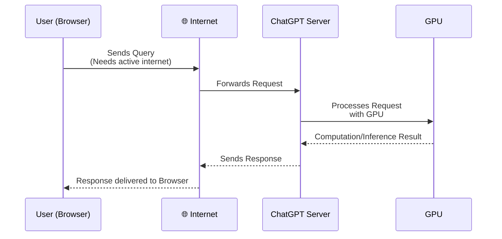

---
# try also 'default' to start simple
theme: default
fonts:
  sans: 'Geist'
  serif: 'Playfair Display'
  mono: 'JetBrains Mono'
# random image from a curated Unsplash collection by Anthony
# like them? see https://unsplash.com/collections/94734566/slidev
# some information about your slides (markdown enabled)as
title: Wait, My Browser Can Do This?
info: |
  Chrome recently released a bunch of AI Web APIs. These allow you to use models locally, and perform various tasks like translation, summarizing, proof-reading, prompting, etc. without making any network requests.
# apply UnoCSS classes to the current slide
class: text-center | bg-white
# https://sli.dev/features/drawing
drawings:
  persist: false
# slide transition: https://sli.dev/guide/animations.html#slide-transitions
transition: none
# enable MDC Syntax: https://sli.dev/features/mdc
mdc: true
# duration of the presentation
duration: 25min
---


# <span class="font-serif text-gray-800">Wait, my browser can do this?</span>
<span class="text-gray-700 text-2xl">A talk at Hackersmang, official pre-summit event for IndiaAI</span>


  
  

<div class="abs-bl m-6 text-xl text-left flex items-center w-full">
  <div class="w-14 aspect-square mr-3 rounded-md">
    
  </div>
  <div>
    <div class="text-2xl text-gray-800">Deveesh Shetty</div>
    <div class="text-lg text-gray-600">Software Engineer, Levels.fyi</div>
  </div>
</div>

<div class="abs-br m-6 text-xl text-gray-900">
  <a href="https://x.com/ShettyDeveesh" target="_blank" class="slidev-icon-btn">
    <carbon:logo-x />
  </a>
  <a href="https://github.com/dev-shetty" target="_blank" class="slidev-icon-btn">
    <carbon:logo-github />
  </a>
</div>

---
transition:  slide-up
class: color-white
---

# <span class="font-serif">Evolution of Browsers</span>

<div class="flex flex-col w-full">
  <div class="border-l-4 border-blue-400 pl-8 py-6 space-y-4 max-w-3xl text-left">
    <div v-click>
      <span class="text-2xl font-serif text-blue-400">1990s:</span>
      <span class="text-lg text-white ml-2">Birth of Browsers - Mosaic, Netscape Navigator bring graphics and usability to the web. <span class="font-semibold text-yellow-300" v-mark.rect.yellow="1">JavaScript invented in 1995.</span></span>
    </div>
    <div v-click>
      <span class="text-2xl font-serif text-green-400">2000s:</span>
      <span class="text-lg text-white ml-2">Internet Explorer dominates. Rise of standards (HTML4, CSS2). Firefox and Opera innovate with tabs and extensions.</span>
    </div>
    <div v-click>
      <span class="text-2xl font-serif text-red-400">2008:</span>
      <span class="text-lg text-white ml-2">Google Chrome launches, introducing speed, sandboxing, and V8 JavaScript engine.</span>
    </div>
    <div v-click>
      <span class="text-2xl font-serif text-yellow-400">2010s:</span>
      <span class="text-lg text-white ml-2">Modern web: HTML5, CSS3, WebAssembly, Progressive Web Apps. Browsers become platforms for apps, not just pages.</span>
    </div>
    <div v-click>
      <span class="text-2xl font-serif text-purple-400">2020s:</span>
      <span class="text-lg text-white ml-2">Privacy focus, multi-device sync, native-like experiences. Agentic Browsers like Atlas and Comet.</span>
    </div>
  </div>
</div>


---

# <span class="font-serif">Why do we use browsers?</span>

<ul class="list-disc text-xl pl-8 pt-4 text-white space-y-2 max-w-xl font-serif">
  <li>Communication & Email</li>
  <li>Watch Videos</li>
  <li>Read News & Articles</li>
  <li>Online Shopping</li>
  <li>Learn & Take Courses</li>
  <li>Finances</li>
  <li><span v-mark.circle.yellow>Social Media & Memes</span></li>
</ul>


---
layout: center
class: text-center
---

# <span class="font-serif">Recently, I realised my browser can do AI Inference</span>

---
layout: center
class: text-center
---

# <span class="font-serif">You might wonder</span>
<span class="text-gray-300 text-2xl">Didn't ChatGPT used to do it from 2022</span>


  
  
  
  
    
  <div class="flex justify-center items-center absolute left-1/2 top-1/2 transform -translate-x-1/2 -translate-y-1/2 w-full h-full">
    
  </div>

---
layout: center
class: text-center
transition: slide-up
---

# <span class="font-serif">Fair</span>

---
layout: center
class: text-center
transition: slide-up
---

# <span class="font-serif">But try turning off your WiFi and use ChatGPT :)</span>

---
layout: center
class: text-center
transition: slide-left
---

# <span class="font-serif">You can't, it needs consitent Internet connection</span>


---

# <span class="font-serif">Here's what happens when you ask ChatGPT</span>

<div class="p-12 -mt-8 w-full h-full">


</div>

<!-- - The **Internet connection** is required for the browser to communicate with ChatGPT servers.
- ChatGPT servers utilize powerful **GPUs** to process natural language requests and generate responses, which are then sent back to the user's browser via the internet. -->

---
layout: center
class: text-center
---

# <span class="font-serif">But, What if i told you my browser can do it without Internet</span>


---
layout: center
class: text-center
---

# <span class="font-serif">You might think it is Atlas or Comet</span>
<span class="text-gray-300 text-2xl">or any other "AgEnTiC bRoWsEr"</span>


---
layout: center
class: text-center
---

# <span class="font-serif">Well, to your surprise it is </span>


---
layout: center
class: text-center
---

  <div class="flex justify-center items-center">
    
  </div>


---
layout: center
class: text-center
---

# <span class="font-serif">Yes, Chrome</span>

<!-- Chrome has consistently pushed the boundaries of what a browser can do - from pioneering DevTools and advanced audio/video codec support to enabling WebGPU, third-party graphics, and now even integrating built-in AI models. -->

---
layout: center
class: text-center
---

# <span class="font-serif"> Okay enough of Yapping, how is this working?</span>


---
layout: center
class: text-center
---

# <span class="font-serif">Here's what happens with Chrome AI</span>
<a href="https://developer.chrome.com/docs/ai/built-in-apis" target="_blank" class="text-gray-300 text-2xl">https://developer.chrome.com/docs/ai/built-in-apis</a>


---

### Integrating Prompt AI API

<br />

````md magic-move {lines: true}
```ts
const isAvailable = await LanguageModel.availability()
```

```ts {3|5,6,12|7-11|9}
const isAvailable = await LanguageModel.availability()

if(!isAvailable) return;

// Download the model
await LanguageModel.create({
  monitor(m) {
    m.addEventListener('downloadprogress', (e) => {
      console.log(`Downloaded ${e.loaded * 100}%`);
    });
  },
});
```

```ts {*|6-11}
const isAvailable = await LanguageModel.availability()

if(!isAvailable) return;

const promptAIModel = await LanguageModel.create({
  initialPrompts: [
    {
      role: "system",
      content: "You are a helpful and friendly assistant.",
    }
  ]
});
```

```ts {14-16|16}
const isAvailable = await LanguageModel.availability()

if(!isAvailable) return;

const promptAIModel = await LanguageModel.create({
  initialPrompts: [
    {
      role: "system",
      content: "You are a helpful and friendly assistant.",
    }
  ]
});

// One shot answer
const result = await promptAIModel.prompt("Best city to live in India?");
console.log(result);
```

```ts {14-15|17,19|18|*}
const isAvailable = await LanguageModel.availability()

if(!isAvailable) return;

const promptAIModel = await LanguageModel.create({
  initialPrompts: [
    {
      role: "system",
      content: "You are a helpful and friendly assistant.",
    }
  ]
});

// Streaming answer
const result = promptAIModel.promptStreaming("Best city to live in India?");

for await (const chunk of result) {
  console.log(chunk);
}
```
````


---
layout: center
class: text-center
transition: fade-out
---

# <span class="font-serif">Let's see it in Action</span>


---
layout: center
class: text-center
---

# <span class="font-serif">Now you might wonder, 300MB-1GB??</span>
<span class="text-gray-300 text-2xl">Are you seriously shipping this to users?</span>


---

# <span class="font-serif">It's still in early stage</span>
<span class="text-gray-300 text-2xl">And a lot of research is happening</span>


<div class="flex flex-col mt-16">
  <ul class="text-gray-300 text-lg max-w-xl space-y-4">
    <li>
      <span class="font-serif text-white text-2xl">Run local apps with AI</span><br>
    </li>
    <li>
      <span class="font-serif text-white text-2xl">Self-host translators and models</span><br>
    </li>
    <li>
      <span class="font-serif text-white text-2xl">Your data is yours</span><br>
    </li>
    <li>
      <span class="font-serif text-white text-2xl">No backdoors</span><br>
    </li>
  </ul>
</div>


---
layout: center
class: text-center
---

# <span class="font-serif">The best part, no need to worry about money while building AI projects.</span>

---
layout: center
class: text-center
---

# <span class="font-serif">Till now chrome was eating your RAM, now it will also eat your GPU :)</span>


---
layout: center
class: text-center
---

# <span class="font-serif">I am also exploring usecases of Chrome AI</span>
<span class="text-gray-300 text-2xl">And might use it in my future apps</span>


---
layout: custom
class: text-white
---

<div class="mb-8">
  <p class="font-serif text-4xl">Deveesh Shetty</p>
  <p class="text-gray-100 text-2xl pt-1">Software Engineer, Levels.fyi</p>
</div>

<div class="w-full h-full flex flex-col">
  <ul class="list-disc text-2xl space-y-0">
    <li>I build Web Applications</li>
    <li>I explore random stuffs</li>
    <li>I write blogs and articles</li>
    <li>I run and volunteer in technical communities</li>
  </ul>
</div>

<div class="abs-br m-8 flex flex-col items-center">
  
  <span class="text-gray-300 text-center pt-2">dev.shetty.me</span>
</div>


---
layout: center
---

<div class="flex items-center justify-center gap-8">
  <div class="bg-white p-4 rounded-lg">
    
  </div>
  <div class="bg-white p-4 rounded-lg">
  
</div>
</div>


---
class: bg-white
---

<div class="flex justify-between items-start w-full">
  
  
</div>

<div class="flex flex-col items-center justify-center">
  
  <span class="text-black text-center pt-2">Get the slides at slides.shetty.me</span>
</div>

<div class="abs-br flex flex-col items-center justify-center m-4">
  
</div>


---
layout: center
class: text-center
---

# <a href="https://brainy-quart-ace.notion.site/Wait-my-browser-can-do-this-2b95e52c1e1980f0975ed3d532dac448?source=copy_link" target="_blank" class="font-serif">Reference Slides</a>


