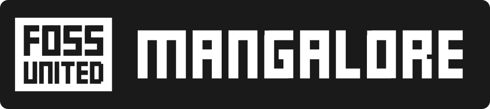
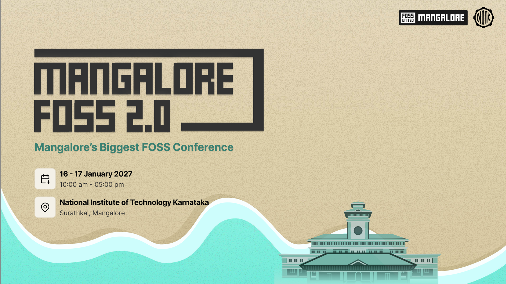

  
$ systemctl status mangalore

<pre class="font-mono text-[0.62rem] leading-[1.0] m-0 mt-4 mb-6 text-gray-100">███████╗ ██████╗ ███████╗███████╗  ██╗   ██╗███╗   ██╗██╗████████╗███████╗██████╗ 
██╔════╝██╔═══██╗██╔════╝██╔════╝  ██║   ██║████╗  ██║██║╚══██╔══╝██╔════╝██╔══██╗
█████╗  ██║   ██║███████╗███████╗  ██║   ██║██╔██╗ ██║██║   ██║   █████╗  ██║  ██║
██╔══╝  ██║   ██║╚════██║╚════██║  ██║   ██║██║╚██╗██║██║   ██║   ██╔══╝  ██║  ██║
██║     ╚██████╔╝███████║███████║  ╚██████╔╝██║ ╚████║██║   ██║   ███████╗██████╔╝
╚═╝      ╚═════╝ ╚══════╝╚══════╝   ╚═════╝ ╚═╝  ╚═══╝╚═╝   ╚═╝   ╚══════╝╚═════╝ 
 
███╗   ███╗ █████╗ ███╗   ██╗ ██████╗  █████╗ ██╗      ██████╗ ██████╗ ███████╗
████╗ ████║██╔══██╗████╗  ██║██╔════╝ ██╔══██╗██║     ██╔═══██╗██╔══██╗██╔════╝
██╔████╔██║███████║██╔██╗ ██║██║  ███╗███████║██║     ██║   ██║██████╔╝█████╗  
██║╚██╔╝██║██╔══██║██║╚██╗██║██║   ██║██╔══██║██║     ██║   ██║██╔══██╗██╔══╝  
██║ ╚═╝ ██║██║  ██║██║ ╚████║╚██████╔╝██║  ██║███████╗╚██████╔╝██║  ██║███████╗
╚═╝     ╚═╝╚═╝  ╚═╝╚═╝  ╚═══╝ ╚═════╝ ╚═╝  ╚═╝╚══════╝ ╚═════╝ ╚═╝  ╚═╝╚══════╝</pre>
  

    
● mangalore.service — community meetup

    

      Active:active (running) since Mar 2024 — every two months
      Trigger:16–17 Jan 2027 — MangaloreFOSS 2.0, NITK Surathkal
    

    

      
Oct 25&nbsp; mangalore[1]: October FOSS Activity — wrkwrk, Udupi

      
Aug 30&nbsp; mangalore[1]: August FOSS Activity — CCC, NITK Surathkal

      
Jun 28&nbsp; mangalore[1]: June FOSS Activity — The Web People, Puttur

    

  

  

  

---

# FOSS United

  FOSS United is a non-profit foundation dedicated to promoting and strengthening the Free and Open Source Software (FOSS) ecosystem in India.

**Key Initiatives:**

- FOSS Fellowship
- 26 City Chapters & 50+ FOSS Clubs
- Events & Job Portal
- Open Source Workshops & Hackathons
- **IndiaFOSS Conference:** 2500+ Attendees

---

# FOSS United Mangalore

  We at FOSS United Mangalore are a community of FOSS enthusiasts, our aim is to promote and strengthen the FOSS ecosystem in Mangalore, and solve societal problems using FOSS.

- We conduct FOSS Acitivties once every 2 months
- We do it in Industries
- We cycle between Mangalore and Udupi
- Host MangaloreFOSS, our annual flagship conference

---

# FOSS Activities in Mangalore

  

---

# Promoting FOSS in colleges

  
  

---

# FOSS Hack 2026 - Winners from our region

  

    
LibreMP

    
Muaz Ismail Mohammed, Jiya Hussain, Iffah Zohara, Mohamed Dhul Kifl

    
Cross-platform wireless casting to EPSON projectors, built by reverse-engineering the EasyMP protocol.

    
🏆 ₹1,00,000

  

  

    
Accessibility & UI fixes

    
Khatija Kaneez, Zaynah Anjum, Jenisha Dsouza

    
Made a Vue.js app screen-reader friendly and cleaned up its dark mode and layout inconsistencies.

    
🏆 ₹10,000

  

  

    
Big-integer JSON fix

    
Vivek Neeralagi

    
Fixed large JSON integers being silently rounded off before reaching the server, in both the app and the CLI.

    
🏅 Commendation

  

---

# MangaloreFOSS

  

    

      Our first edition was held on 17-18 January 2026
    

    <ul class="list-disc pl-6 text-base space-y-2">
      <li>Biggest FOSS Conference in Mangalore</li>
      <li>Largest CityFOSS Conference in India</li>
      <li>600+ attendees</li>
      <li>25+ Speakers</li>
      <li>15+ Talks and 4 Workshops</li>
      <li>10 Community Booths</li>
      <li>Speakers from Zerodha, Linux Foundation, IBM, etc.</li>
    </ul>
  

  

    
    
    
        
  

---

# MangaloreFOSS

  

---
layout: center
---

  

---

# MangaloreFOSS 2.0

  
  

    
    
RSVP here

  

---

# Join our Telegram Community

  

