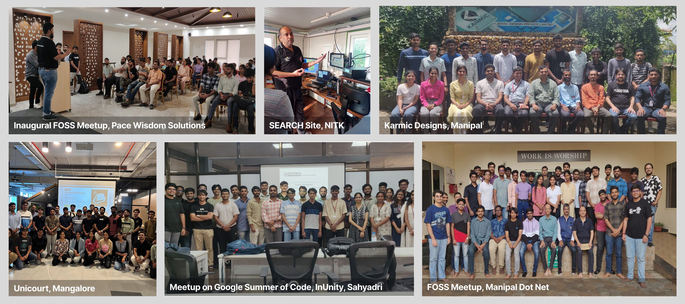
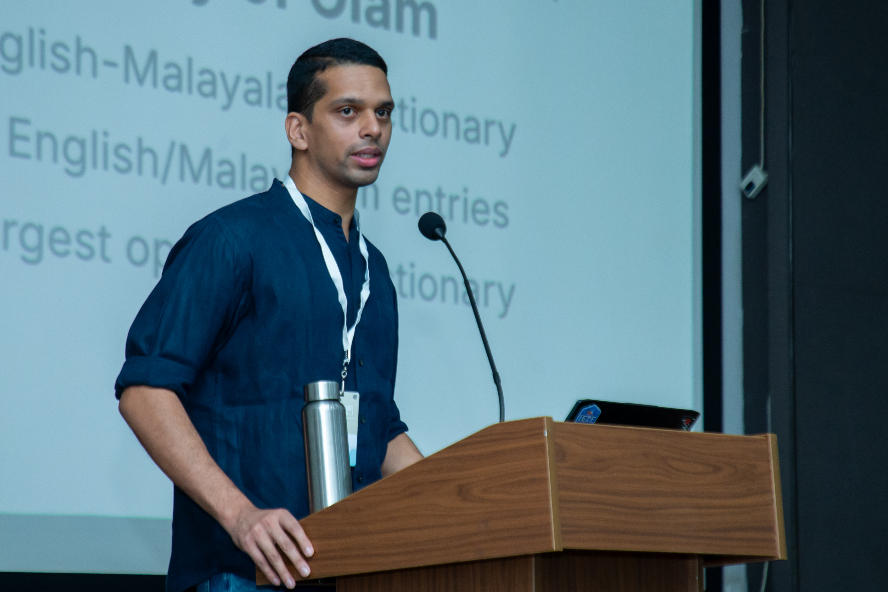
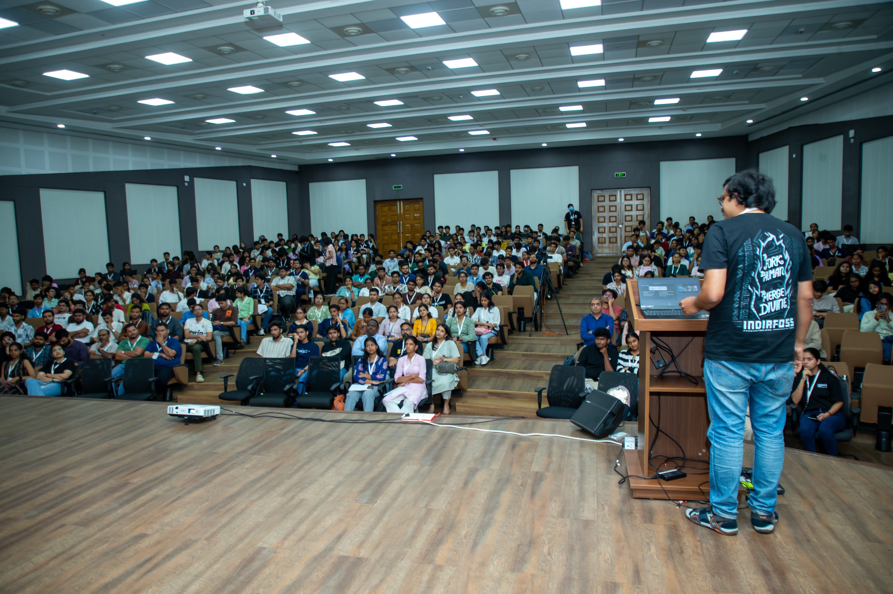
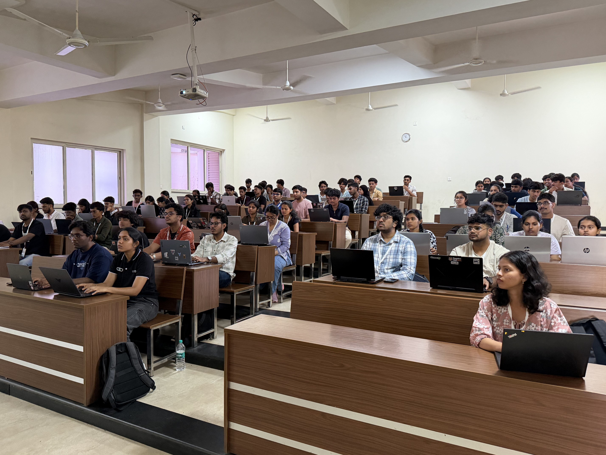
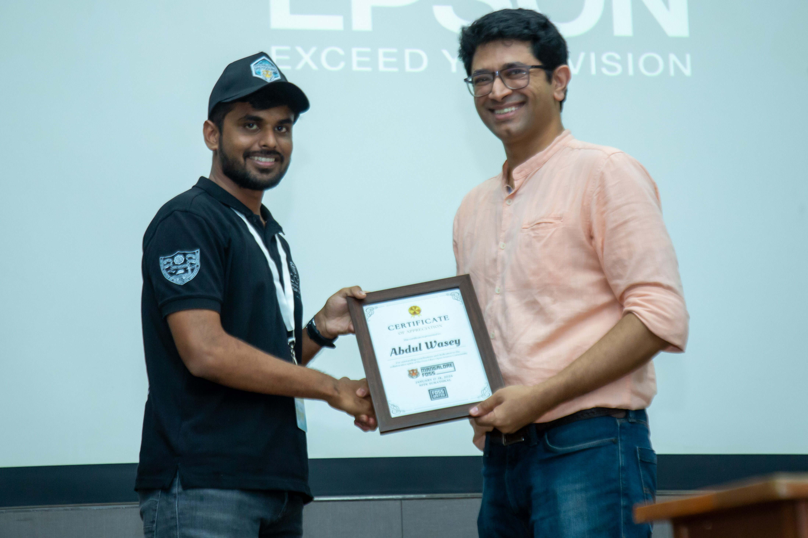
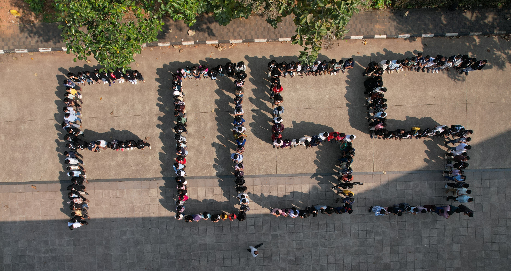
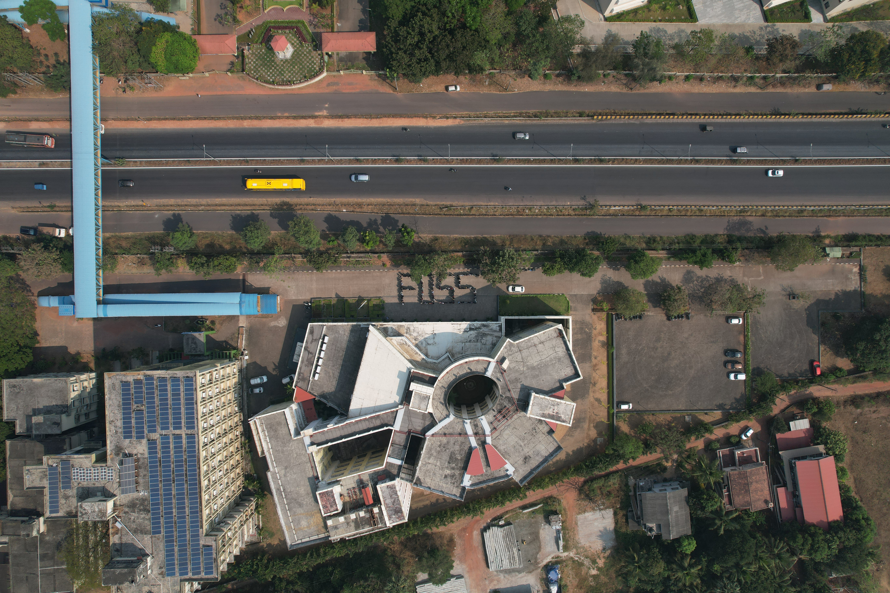
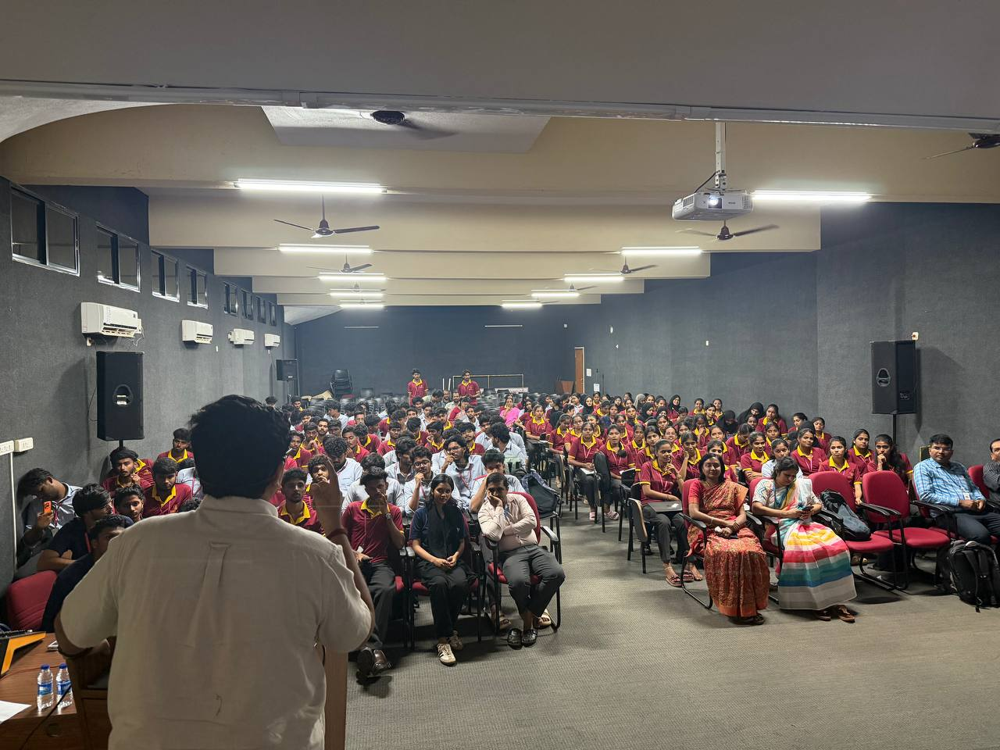
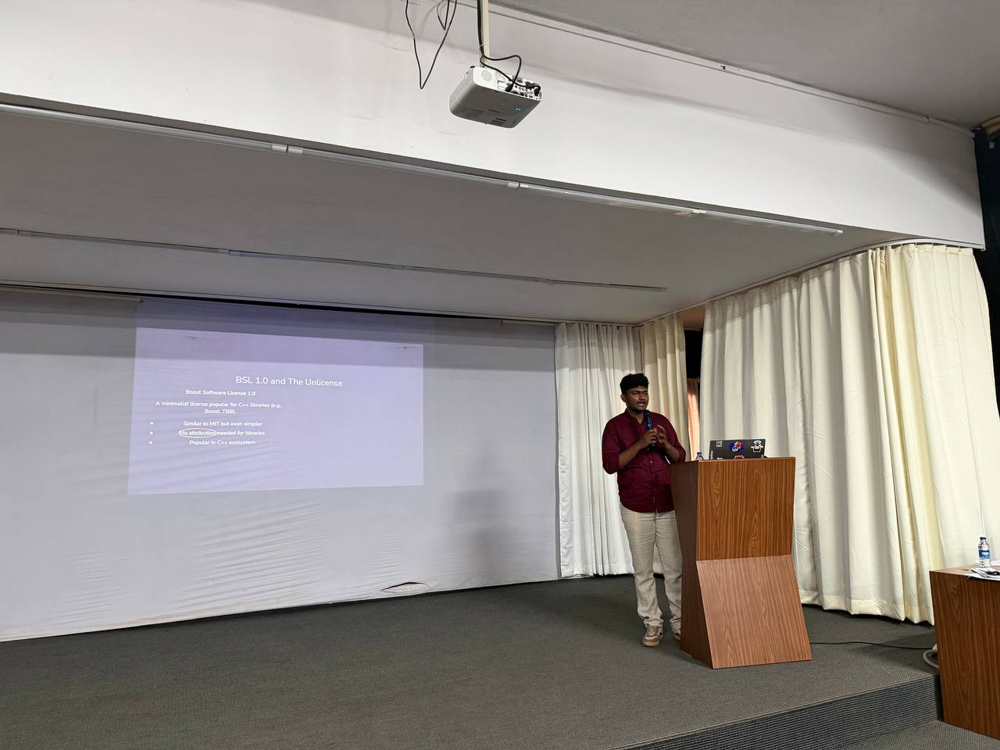
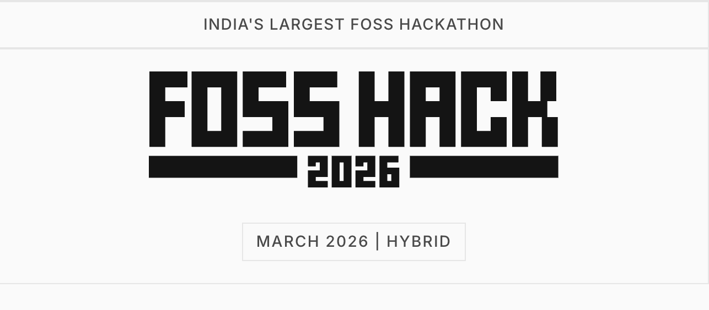

---
# try also 'default' to start simple
theme: default
# random image from a curated Unsplash collection by Anthony
# like them? see https://unsplash.com/collections/94734566/slidev
# some information about your slides (markdown enabled)
title: FOSS United Mangalore
info: |
  ## FOSS United Mangalore
  Presentation slides for FOSS United Mangalore.

  Learn more at [FOSS United Mangalore](https://fossunited.org/c/mangalore)
# apply UnoCSS classes to the current slide
class: text-center
# https://sli.dev/features/drawing
drawings:
  persist: false
# slide transition: https://sli.dev/guide/animations.html#slide-transitions
transition: view-transition
# enable MDC Syntax: https://sli.dev/features/mdc
mdc: true
# duration of the presentation
duration: 10min
---

# FOSS United Mangalore

  

  

---

# FOSS United

  FOSS United is a non-profit foundation dedicated to promoting and strengthening the Free and Open Source Software (FOSS) ecosystem in India.

**Key Initiatives:**
- FOSS Fellowship
- 26 City Chapters & 50+ FOSS Clubs
- Events & Job Portal
- Open Source Workshops & Hackathons
- **IndiaFOSS Conference:** 2500+ Attendees

---

# FOSS United Mangalore

  We at FOSS United Mangalore are a community of FOSS enthusiasts, our aim is to promote and strengthen the FOSS ecosystem in Mangalore, and solve societal problems using FOSS.

- We conduct FOSS Acitivties once every 2 months
- We do it in Industries
- We cycle between Mangalore and Udupi
- Host MangaloreFOSS, our annual flagship conference

---

# FOSS Activities in Mangalore

  

---

# MangaloreFOSS

  

    

      Our first edition was held on 17-18 January 2026
    

    <ul class="list-disc pl-6 text-base space-y-2">
      <li>Biggest FOSS Conference in Mangalore</li>
      <li>600+ attendees</li>
      <li>25+ Speakers</li>
      <li>15+ Talks and 4 Workshops</li>
      <li>10 Community Booths</li>
      <li>Speakers from Zerodha, Linux Foundation, IBM, etc.</li>
    </ul>
  

  

    
    
    
        
  

---

# MangaloreFOSS

  

---
layout: center
---

  

---

# Promoting FOSS in colleges

  
  

---

# What's upcoming?

  
  

---

# Join our Telegram Community

  

